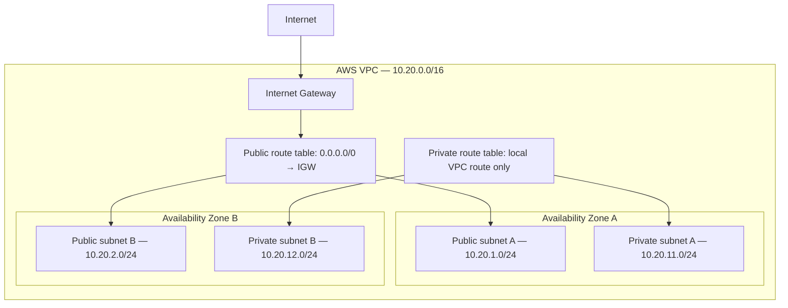
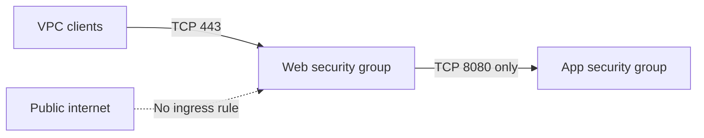

# AWS VPC — Architecture and Design Decisions

This conceptual diagram describes the Terraform resources under `05-aws-vpc-terraform-lab/`. It is **not** evidence that the resources have been deployed.



## Why it is designed this way

| Decision | Reason | Limitation |
| --- | --- | --- |
| Split across two AWS Availability Zones | Prepares for workloads with zonal redundancy | The configuration does not create highly available applications |
| Two public subnet associations | Enables an internet route through the gateway | Public subnet resources do not automatically receive public IP addresses |
| Two private subnet associations | Keeps workloads on a private-only route table by default | No outbound internet; add narrowly scoped endpoints or a cost-reviewed NAT architecture later |
| No NAT gateway or Elastic IP | Avoids fixed NAT hourly/data fees for an undeployed lab | Private workloads cannot download software via the internet |
| No EC2 instances or load balancers | Keeps this module focused on core networking | No application is deployed or reachable |
| No automatically assigned public IPs | Reduces accidental public exposure | Public resources would need separate, explicit IP assignments |
| Explicit route-table associations | Avoids reliance on whichever route table is the VPC main route table | Requires disciplined updates when adding subnets |

## Workload security policy (future use)



- `aws_security_group.web` and `aws_security_group.app` define network-interface policies for workloads that might be added later. They are **not attached to subnets** and do not deploy workloads.
- `aws_vpc_security_group_ingress_rule.web_https_from_vpc` allows HTTPS **from the VPC CIDR only**, never the whole internet.
- `aws_vpc_security_group_ingress_rule.app_from_web` allows inbound TCP 8080 from network interfaces with the web security group.
- `aws_vpc_security_group_egress_rule.web_to_app` permits web-tier outbound TCP 8080 toward the app tier.
- No SSH rule or internet-wide egress rule is intentionally declared. AWS-generated default egress and out-of-band modifications require verification after a separately authorized live deployment.

**Production caveat:** An internet gateway alone does not expose a host; IP addresses, security groups, network ACLs, OS firewalls, and service listeners must all be configured appropriately. This is a training foundation rather than a complete production landing zone.

## Infrastructure-to-code map

- `aws_vpc.lab`: the virtual network and its RFC1918 address range.
- `aws_internet_gateway.lab`: gateway attached to the VPC.
- `aws_subnet.public[*]` and `aws_subnet.private[*]`: separate networks for two zones.
- `aws_route_table.public`: default IPv4 route via the internet gateway.
- `aws_route_table.private`: no configured default internet route, only AWS-managed local VPC routing.
- `aws_route_table_association.*`: binds each subnet to the correct route table.
- `data.aws_availability_zones.available`: pins the two explicitly allowlisted zone IDs from `var.availability_zone_ids`, avoiding newly added Availability Zones changing the selection unexpectedly. Defaults are specific to `us-east-1`; override these IDs when changing regions.
- `aws_default_security_group.locked_down`: adopts and removes default inbound and outbound permissions from the VPC's automatically created default security group; only appropriate for a new or carefully reviewed VPC.

## Tests

The `tests/network.tftest.hcl` and `tests/security.tftest.hcl` suites replace the AWS provider with a **mock provider** and use plans and simulated applies; they do **not** create AWS infrastructure. The suite verifies subnet counts, CIDRs, distinct AZ placements, public IP assignment policy, and route table association counts. The tests do not validate network reachability or real AWS account policy.

```sh
terraform init -backend=false -lockfile=readonly
terraform fmt -check -recursive
terraform validate
terraform test -no-color
```

Do not run `terraform apply` for these tests.
