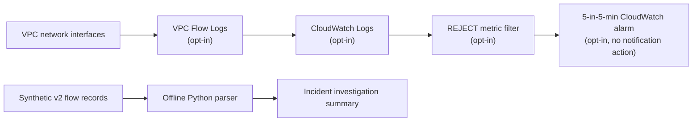

# Observability and Incident Investigation — AWS VPC Lab

**Mode:** offline + simulation. A separate, optional Terraform configuration models real CloudWatch resources, but its switch defaults to **off**. No AWS account is needed for these exercises.

## Conceptual monitoring pipeline



## Cost controls and resource behavior

- `enable_flow_logs = false` is the default; **all** live Flow Logs / CloudWatch / IAM delivery resources in `observability.tf` are gated behind it.
- Enabling flow logging and alarms can incur log ingestion, storage, metrics and alarm charges, and might require additional IAM permissions. CloudWatch log retention defaults to 7 days when opted in.
- The modeled alarm detects **at least 5 REJECT records within a 5-minute period**. It is illustrative, not tuned to a real-world traffic baseline; no SNS notification actions are configured.
- Terraform code and tests don't prove AWS account permissions, live route behavior, or real alert delivery. Do not run `terraform apply` for this project without separate authorization and a cost review.

## Commands to practice locally (does not deploy AWS resources)

From the `05-aws-vpc-terraform-lab` directory:

```sh
python3 observability/analyze_flow_logs.py observability/sample-flow-logs.log
python3 -m unittest discover -s observability -p 'test_*.py' -v
terraform init -backend=false -lockfile=readonly
terraform validate
terraform test -no-color
```

- `python3` runs the offline log analyzer.
- `-m unittest discover` searches for test modules and runs them.
- `terraform init` downloads the locked AWS provider without creating resources.
- `terraform validate` checks structural correctness.
- `terraform test` exercises mocked provider scenarios, including the monitoring opt-in switch. A mocked `apply` is only an in-memory simulation, not an AWS API call.

## How to read default VPC Flow Logs v2 records

Fields: `version account-id interface-id srcaddr dstaddr srcport dstport protocol packets bytes start end action log-status`. The sample uses AWS documentation-only example ranges such as `198.51.100.0/24` and `203.0.113.0/24`; all records are **fabricated**.

- `ACCEPT` means the traffic was allowed by security group/NACL filtering at capture; it **does not prove** the application responded successfully.
- `REJECT` may indicate a security group/NACL denial, a closed connection, or other filtering conditions; it **does not identify root cause** without additional evidence.
- `NODATA` and `SKIPDATA` are statuses rather than accept/reject traffic events. The Python tool excludes them from action counts and reports their counts separately.
- Rejected source IP counts suggest investigation leads, not confirmed attackers. IPs can represent NATs, proxies or legitimate testing.

## Reproducible case study: external HTTPS rejected

**Scenario:** Synthetic records show inbound HTTPS `198.51.100.18 → 10.20.1.10:443` rejected. Our web SG allows HTTPS **only from the internal VPC CIDR**, so the denial is consistent with the modeled security policy. It does not prove a real AWS service was running.

**Triage workflow:** (1) verify the source/destination and ports in the offline summary, (2) inspect Terraform `security.tf` rules, (3) check route tables and subnet public-IP policy, (4) identify any missing listener or workload, and (5) explain why broadening ingress to `0.0.0.0/0` is not an appropriate first fix.

**Additional examples:** SG-referenced web-to-app TCP 8080 ACCEPT traffic, blocked SSH to TCP 22, and a private-tier egress attempt to `203.0.113.9:443`. Do **not** assume every private egress routing failure would generate a `REJECT` flow record; Flow Logs are not a packet-capture tool.

## Example CloudWatch Logs Insights query (not executed)

For default v2 records delivered to a CloudWatch Logs group, use a query like:

```text
fields @timestamp, srcAddr, dstAddr, dstPort, action, logStatus
| filter action = "REJECT"
| stats count(*) as rejectedRecords by srcAddr, dstPort
| sort rejectedRecords desc
| limit 20
```

This is illustrative. Field discovery and naming depend on the actual log format and delivery integration, and querying live data can incur charges. No live queries were performed.

## What evidence belongs in the portfolio

- Link to the GitHub Actions run demonstrating the Python analyzer's unit tests and mocked Terraform checks.
- Clearly label the fixture as **synthetic**, and distinguish static CI evidence from live AWS observability.
- Record the incident hypothesis, supporting sample rows, suspected controls, and limits of the conclusion.
- Never commit credentials, real private logs, account identifiers, or sensitive customer data.
